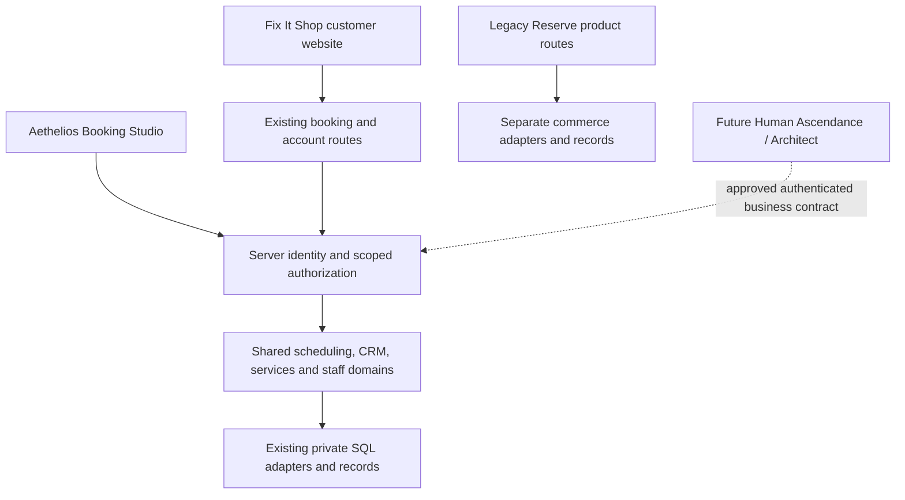

# Aethelios Booking platform foundation

Audit date: October 12, 2026. Baseline: main
`e533089b1b283240d46ce4847d631354ded860a9`, confirmed through GitHub and
matching the clean local checkout. This is a review proposal, not approval to
change hosted data, authentication, domains, payments or production. Read
[the existing Phase One implementation](FIX-IT-AETHELIOS-PHASE-ONE.md) first;
its customer/operator identity work is already on main and is not rebuilt here.

## 1. Existing implementation audit

Reviewed README, AGENTS, Phase One, architecture/Chair/booking/provider release
documents, tracked route/module/test/migration inventory, auth/proxy/origin checks,
Studio capabilities, manifests/icons, CI and Next configuration. Historical
documents contain superseded brand and launch instructions; current AGENTS and
the founder's approval boundaries take precedence.

| Area | Confirmed implementation on main | Limit / evidence |
| --- | --- | --- |
| Customer identity | `/` leads to `/fix-it-shop/app`; Katie's premium world, approved customer crest and steel phone symbol remain | `app/page.tsx`, `lib/fix-it-booking.ts`, Phase One asset provenance; approved portrait retained |
| Shared booking | Service/location eligibility, availability, transactional occupancy, captured price/duration/buffer, idempotency, revision-bound reschedule/cancel, calendar output | `lib/booking.ts`, appointment/availability APIs; this is reusable scheduling, not a Katie-only engine |
| Customer relationships | Account-owned appointments, paginated full history, provider-bound CRM-only contacts/imports and manual staff bookings | `reserve_clients`, `lib/booking-pilot.ts`; Katie-filtered history does not replace `/account` full history |
| Operations | Day/week schedule, blocks, clients/history, completion, manual confirmation queue, approved service/hour proposals and insights | Studio/pilot/day/operations domains; no verified automatic reminders on main |
| Provider branding | Reviewed published snapshots, private drafts/assets/events, provider/location assignments and generated apps/manifests | `lib/provider-brands.ts`, `lib/booking-identity.ts`; not independent business tenancy |
| Auth and permissions | Supabase PKCE, request-local SSR clients, server `getUser()`, database roles/capability overrides and provider checks | `lib/auth.ts`, `proxy.ts`, `lib/studio-permissions.ts`; editable metadata supplies display name only |
| Chair | Explicit sharing with Katie and administrator, separate life-context consent/expiry, revocation/deletion, private provider notes | `lib/chair-store.ts`, `migrations/002_chair.sql` and later note evolution; no automatic sharing with new staff/providers |
| PWA | Root and nested Fix It Shop manifests; provider manifests; approved existing icon exports | No service-worker registration/cache implementation found; online private operations only |
| Persistence | Hosted server SQL and nonproduction PGlite; private RLS tables and grant lockdown; migration history preserved | `lib/db.ts`, `lib/studio-lockdown.ts`, `migrations/`; no business-membership table on main |
| Commerce | Existing Square seam and Shopify collection/cart paths, independent historical membership/Vitalis surfaces | Preserve flags, mappings, orders and receipts; do not consolidate service/product revenue |
| Validation | Unit/domain suites, TypeScript/build, synthetic booking/pilot/Chair/provider/browser scripts and GitHub CI | Local tests do not prove hosted Auth, grants, concurrency or actual phone installation |

### Open work reconciliation

GitHub open-PR inventory was read before edits. Relevant patches for #52, #59 and #65
were inspected; #52's connection design and #12's organization model are proposals,
not facts about main.

| Draft | Decision for this release |
| --- | --- |
| #59 independent Fix It Shop edition (`apps/fix-it-shop`) | Do not import a second assembled application. Its provider restriction does not establish business memberships. Current main already has the customer brand |
| #65 booking notifications/migration safeguards | Separate review on the same main baseline; do not duplicate its disabled email worker or migrator changes. No automatic delivery acceptance inferred |
| #52 Public Aethelios connections/website publication | Do not activate or import. Requires business-scoped authority and a separately approved integration contract |
| #5 organization foundation; #12 multi-location operating model | Reconcile terminology and data ownership before any future additive migration; their older migration numbering/schema assumptions must not be applied to current main blindly |
| #6–7 historical brand/Auth handoff | Superseded positioning and external project assumptions must not replace configured Auth or existing identities |
| #10–14, #17 cinematic/entry/continuity; #22 Command | Compare individual changes with current main before reuse; no wholesale merge of old stacks |
| #15–16 commerce; #60–61 shopping/product universe | Separate product workstreams. Do not import processors, schemas or shopping AI into Fix It Shop booking scope |

Phase One references #62 as a former draft; it is absent from the current open
inventory and its identity implementation is already present on main.

### Vercel observation (read-only)

Connected project: `reserve-at-sanctum-app`,
`prj_GKN7RVVFAiQfWdTpHT63e0wNydgn`, team `team_LJpmefIarra3F19Ad9QpGqMx`.
Next.js, configured Node `24.x`. Latest returned production deployment is READY,
`dpl_HttBfcdJqM7d6wV7fE18BQ2km5Bv`, at the baseline SHA above. A ready build is
not booking acceptance. Project response reports `live:false`; that field alone
does not establish public reachability or launch status.

Both custom domains are verified. **An existing Vercel 308 sends
`reserveatsanctum.app` to `www.reserveatsanctum.app`; the www domain has no
configured project redirect. Preserve this existing arrangement.** No domain was
added, removed, reassigned or redirected by this work. Returned password/SSO/IP
protection settings are disabled; deployment access should be reviewed before
private hosted pilot data is used. Local Next config supplies noindex, security
headers and API no-store; noindex is not access control. No local `.vercel` link
or `vercel.json` was found. Environment values/secrets, live database contents,
Auth provider configuration and actual DNS resolution were not inspected.

## 2. Confirmed reusable capabilities

Reuse the existing domains and adapters in this repository: booking/availability,
occupancy, client history/CRM, staff calendar/blocks, service configuration,
provider presentation, server identity/capability checks and audit/revisions.
Routes are presentation adapters; provider branding is configuration; neither
requires cloning the scheduler. Preserve `reserve_*` persistence identifiers,
provider IDs, auth IDs, appointment snapshots and commercial adapter boundaries.

## 3. Architectural gaps

* A single `reserve_users.role` and `provider_id` cannot express membership in
  multiple independent businesses, multiple provider assignments, business
  ownership or immediate membership revocation. `owner` has platform-wide reach.
* CRM rows are provider-bound, not a business customer relationship. A login is
  global identity; it must not imply shared customer notes across businesses.
* Locations and provider brand slugs are not tenants. Service/provider foreign
  keys alone do not enforce business consistency across appointments/customers.
* Chair sharing is specifically Katie/administrator consent. A business-owner
  label cannot expand that consent to a whole team.
* Studio inherits the Fix It Shop root manifest/icons. There is no independently
  approved operator icon or operator PWA. Root/nested scopes overlap.
* Mutation origin validation and some Auth/recovery configuration use a single
  `APP_ORIGIN`. Merely attaching two domains would reject valid mutations on one
  or break return journeys; do not loosen origin checks to solve this.
* Hosted catalog, identities/grants, recovery/session persistence, delivery and
  phone acceptance remain unproven here. No public multi-business readiness claim.

## 4. Recommended platform structure

Keep one Next application and one shared engine. Fix It Shop remains the customer
world; `/studio/**` is Aethelios Booking's authenticated operating environment.
Keep Legacy Reserve's historical routes/records in place until a separately
reviewed transfer destination and data plan exists. Do not alter Human Ascendance.

Future business context must be resolved on the server from a trusted domain/route
mapping plus verified active membership. Route, brand, request body and query
values are selectors, never grants. Keep domain authorization in server domains
as well as routes; do not rely on navigation hiding or PWA scope.

## 5. Exact URL/domain proposal

**Candidates only; ownership and availability are unverified.** No acquisition,
DNS, redirect or host-routing implementation is included.

| Identity | Proposed canonical origin and paths | Existing paths during transition |
| --- | --- | --- |
| Fix It Shop | `https://fixitshop.app/` customer entrance; `/fix-it-shop/app/book`, `/fix-it-shop/app/appointments`, `/fix-it-shop`, `/chair`, `/auth/callback` | Preserve all current www-domain URLs and queries; initially keep internal paths to avoid rewriting booking/Auth contracts |
| Aethelios Booking | `https://booking.aethelios.app/studio` operator entrance; `/signin?next=/studio`, `/studio/**`, `/auth/callback` | Keep current same-origin Studio for Katie's working installed launch |
| Reserve / Legacy Reserve history | `https://www.reserveatsanctum.app/shop`, `/account`, `/discover`, `/home` and the Phase One retained route families | Keep existing apex-to-www 308 and current `/` behavior; do not repurpose the legacy root without approval |

If candidates are unavailable, choose owned alternatives with the same distinct
origin model before implementing. Attaching multiple origins to the current
project is feasible: Vercel domains can serve the same build and Next can select
presentation by an explicit host mapping. However, host-aware root/metadata,
strict per-origin mutation/callback checks and relative links must be designed
and tested first. APIs stay same-origin on each branded origin; no cross-origin
browser API/CORS scheme is necessary. Keep historical capabilities authorized
regardless of which host serves them.

**Do not add a second deployment now.** Distinct origins provide PWA/storage
separation without a separate application. A second deployment becomes justified
only by demonstrated independent release/configuration needs (for example, an
approved pilot that cannot safely separate origin-specific Auth configuration in
one project), not by branding alone. Neither option solves SQL business isolation.

Auth implications: cookies are currently default host-bound (no shared Domain
override); sessions on the same origin are shared across routes. Distinct origins
should retain host-bound cookies and normally require separate sign-in even when
using the same Supabase identities. A shared account does not grant business
membership. PKCE verification must return to the initiating origin's exact
allowlisted callback; recovery/email links and Site URL behavior need explicit
per-origin acceptance. Never copy tokens into URLs or widen cookies to the parent
domain. Before implementation, approve the host registry and exact allowed
origins, preserve legacy callbacks, reject unknown hosts/foreign Origins and
validate spoofed forwarded-host inputs. Preserve no-store on refreshed sessions.

## 6. PWA identity strategy

| Current manifest | ID | Scope / start | Required preservation |
| --- | --- | --- | --- |
| `/manifest.webmanifest` | `/` | `/`, `/enter` | Existing root installations retain this ID and approved Fix It Shop icons |
| `/fix-it-shop/booking.webmanifest` | `/fix-it-shop/app` | `/`, `/fix-it-shop/app/launch` | Existing nested installations retain ID and current role-aware launch |
| `/providers/[slug]/booking.webmanifest` | `/providers/[slug]/app` | `/providers/[slug]/`, app root | Reviewed provider assets and identities remain; narrower scope can leave standalone context for auth/Studio |

Root and nested IDs differ but both cover `/`; browsers may choose an existing
installation for overlapping links. Two path manifests do not guarantee separate
installed apps or separate sessions. No worker caches private data, tokens or
offline mutations; do not add one just to make installation look complete.

Future approved distinct origins can each have a root-scoped identity. Moving
origins creates a new installed identity even if the path ID is the same: keep old
launch URLs working and provide explicit install/sign-in guidance; do not promise
automatic migration. Keep the approved Fix It Shop symbol. Operator installation
waits for an approved Aethelios Booking icon: do not reuse Katie's symbol or invent
one. Agree its new ID/start (`/studio` with verified auth), scope and update policy
before publishing. Preserve same-origin Katie installed entry meanwhile; its
staff launch does not mean the app has an independent operator identity.

## 7. Permissions and data-isolation plan (design, not migrated)

| Concept | Future authoritative boundary |
| --- | --- |
| Business | Stable business ID, status and explicit owner membership; branding is a separate configuration record |
| Membership | Verified user ID + business ID, role/capabilities, active/revoked status and revision; multiple memberships allowed |
| Staff/provider assignment | Membership + authorized providers within that business; no single global provider field as the only boundary |
| Customers | Business-owned relationship referencing optional existing Auth identity; provider-specific notes remain narrower; never merge by guessed email |
| Services/appointments | Valid business/provider/location/customer relationship enforced in SQL and domains; preserve captured historical terms |
| Branding/configuration | Business-level publication separate from provider presentation; only authorized business roles approve their own changes |
| Revocation | Re-read active membership for each private operation; disable assignments and delegated credentials, invalidate scoped caches; lock/check membership during writes so revocation cannot race a commit |
| Platform maintenance | Existing owner is administrator, not Katie's business authority. Future exceptional access should be explicit and audited; no automatic Chair-consent expansion |

Katie's intended business-owner membership may administer Fix It Shop's approved
services, staff, branding and scheduling, **never** other businesses or Legacy
Reserve product commerce. Until that layer is implemented and verified, keep her
current server-assigned provider authority; do not grant global `owner`.

Future additive schema design must inventory every private table/query, map
existing rows through verified provider ownership, and use composite constraints
to prevent cross-business joins/assignments. Ambiguous/shared historical records
must be reconciled, not silently assigned to Katie or hidden. Retain IDs and
account history; no table rename, deletion or appointment rewrite. Keep global
provider occupancy where the same professional works across businesses, so new
business keys cannot allow double-booking. Preserve idempotency semantics and
define business scope before changing request-key uniqueness.

Chair remains its own consent domain: business membership alone grants no new
sharing. New professional recipients require an approved explicit consent model;
life context retains seven-day expiry and revocation. No notes/life answers in
general AI, cross-company analytics or integration events. Browser SQL access
remains denied; server SQL must enforce membership and relational scope, since
private RLS without browser policies does not tenant-filter privileged queries.

Human Ascendance/Architect seam is a future domain adapter, not a deployed API:
authenticated, revocable delegated credentials with business/provider/action
scope; minimal availability/appointment outputs, expected revisions, idempotency
and actor audit. No credential is created and no integration activated here.
Reconcile #52 only after its independent contract is approved.

## 8. Minimal implementation roadmap

1. **This PR:** audit and contracts; correct generic Studio's misleading Fix It
   Shop affiliation using verified existing provider/role presentation. Preserve
   all authorization, IDs, assets, routes, schemas and configuration.
2. **Launch rehearsal:** founder approves real catalog/hours/address/policies and
   verified Katie identity/provider assignment. Run hosted synthetic rehearsal,
   recovery/refresh, booking conflict/history/Chair revocation and real phones.
   Review #65 separately if automatic communication is required.
3. **Business authority:** review an additive design and mapping/backup/restore
   evidence; implement memberships and scoped domains together behind closed
   activation. Verify two synthetic businesses, multiple providers, revocation,
   cross-business FK/IDOR/history/export denial and shared-provider concurrency.
   Hosted schema application requires explicit founder approval.
4. **Origins and installation:** approve owned domains/operator asset and host/Auth
   design, test isolated hosts and cookies, then separately approve domain/Auth
   configuration. Preserve old launches; no public business onboarding.
5. **Later only:** approve Human Ascendance/Architect contracts before integration.
   No SaaS billing, AI receptionist, new CRM/processors, marketplace or publishing.

## Validation and release evidence

Current-run results:

* `npm run typecheck`: passed.
* `npm test`: 33/36 test files passed. `loading-reliability` cannot bind a local
  socket (EPERM); `restart` and three `supabase-config` assertions receive empty
  subprocess output. A direct diagnostic run confirms these five failures; they
  are not reported as passes.
* Focused in-process run of booking, booking pilot, Chair, provider brands,
  Reserve Studio, Studio operations, Fix It Shop and operator identity: **48/48
  assertions passed**, including concurrency, ownership/history, provider denial,
  revocation, configuration and stable manifest IDs.
* Standard production build compiled, then failed parsing TypeScript CLI
  `--showConfig` output. A complete production build passed with installed Next's
  documented temporary `experimental.useTypeScriptCli:false` compiler-API mode.
  Original `next.config.ts` and generated `next-env.d.ts` were restored; no checker
  was skipped and no build configuration change is in this PR.
* Existing Fix It Shop booking, booking pilot, Chair and provider-brand browser
  scripts were attempted; their local servers could not start. Direct Next dev
  confirms `listen EPERM 127.0.0.1:3000`. No rendering/browser acceptance is claimed.
* `git diff --check`: passed; no migration, Auth/payment config, manifest ID,
  approved asset or persisted-data change is included.

Use only
synthetic preview identities/PGlite; never run a hosted migration/provisioning
command for verification. Existing migration and approved asset bytes must remain
unchanged. Local build success cannot prove live database/catalog readiness.

Production acceptance still requires approved data/configuration, verified Auth
callbacks/providers/recovery/session persistence, runtime grants/migration history,
hosted concurrency, full customer/staff history and Chair consent/revocation,
backup/restore evidence, private pilot access, physical Android/iOS install/reopen/
update checks, and founder review of the exact release. No merge/deployment is
authorized by this document. Rollback of this PR is application/document revert;
no data rollback is needed.

References: [Supabase SSR advanced guide](https://supabase.com/docs/guides/auth/server-side/advanced-guide)
and PKCE redirect troubleshooting were retrieved through connected docs. Installed
Next 16.3.5 metadata/manifest guidance was read. Changelog HTTP retrieval and
public-site HTTP verification were unavailable because the executor proxy was
unreachable; no Auth feature/version/schema change was attempted.
