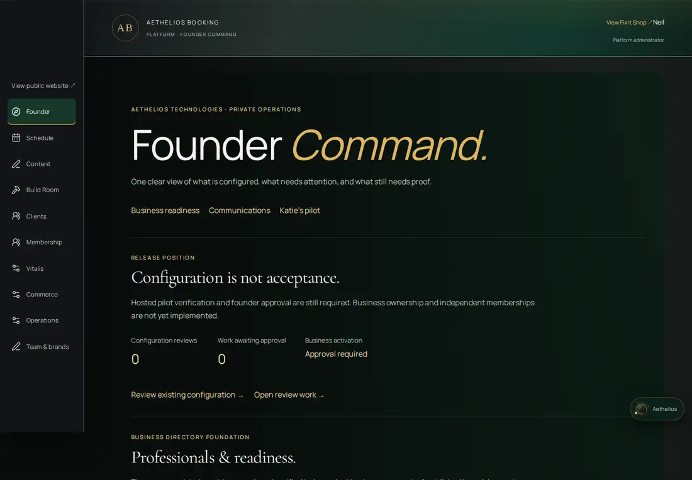
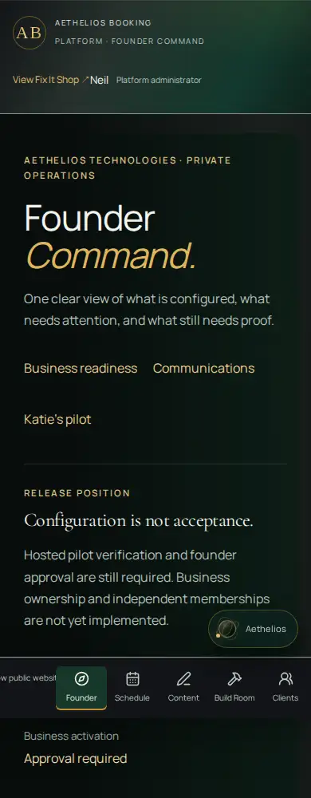

# Founder Command — communications and commissioning evidence

Review increment, October 12, 2026. No production deployment, hosted SQL, role
assignment, real booking, live send, scheduling or activation is authorized by
this document. GlossGenius remains the operational fallback.

## Reconciliation before implementation

GitHub main was verified at `e533089b1b283240d46ce4847d631354ded860a9`.
The local `origin/main` is stale and was not used. The working tree started clean.
README, AGENTS, architecture, Phase One, migrations, booking/occupancy,
provider-branding, configuration proposals, Auth/proxy/capabilities, Chair,
delivery/receipts, tests and GitHub CI/Next deployment configuration were reviewed.

| Existing work | State at this audit | Integration decision |
| --- | --- | --- |
| Fix It Shop customer identity, approved Katie imagery, shared booking, history, calendar, Studio, provider branding/configuration | On main; synthetic suites exist; real business configuration and hosted acceptance unproven | Preserve customer world and engine |
| #65 `4ca705c` | Open draft, disabled Resend worker and reviewed migration runner | Required parent of #67; do not bypass |
| #66 `248c445` | Open draft, platform contract/docs plus affiliation label helper; no business tenancy | Read full contract and selectively reconcile affiliation fix; do not import older branch wholesale |
| #67 `c82ae46` | Open draft based on #65; attendance, signed receipt projection, suppression, commissioning checks; GitHub verification succeeds | This increment stacks on #67 |
| #59 second independent app, #52 external connections, older organization/commerce/Command stacks | Unmerged alternatives; not current authority | Excluded; no second app, commerce or Human Ascendance changes |
| Newer work | Open-PR inventory has no PR newer than #67 at audit | Recheck refs before creating review branch |

#66 and this PR touch Studio labels. If #66 is merged independently, reconcile
its exact helper/layout edits with this PR; keep its design document, but treat
historical owner/Chair access descriptions as superseded by this privacy fix.
Review order is #65 → #67 → this increment, retargeting each after its parent is
approved. Nothing has been merged or promoted by this work. Current Vercel production metadata
was rechecked: READY deployment `dpl_HttBfcdJqM7d6wV7fE18BQ2km5Bv` still
uses main `e533089`; it does not contain #65, #67 or this increment.

## What this increment completes

The platform administrator's `/studio` entry is **Founder Command**, using the
existing verified server role. Katie/provider accounts still resolve to Today;
customers retain their own account entrance. The generic shell now labels the
platform founder and unrelated providers accurately. `owner` remains the legacy
platform role identifier; no new business-owner authority is manufactured.

The console reads a bounded provider directory, enabled service and associated
location counts, address/hour prerequisites, scoped account counts, Auth email
confirmation counts when `auth.users` is readable, brand publication evidence,
existing configuration/work reviews, aggregate booking message/receipt states,
and recent operational brand events. It excludes contact names, addresses,
recipient email, message IDs, proposal bodies, customer notes and Chair data.
Auth confirmation is unavailable in the synthetic preview rather than inferred
from a preview identity. Missing Auth read privileges leave confirmation unavailable
without hiding the provider directory; do not broaden Auth grants for this screen. A provider record is not a verified business account.

Each directory/communication/approval/audit section fails independently to
**unavailable**, not zero. Empty tables show genuine empty states. Reload reads
fresh records. Existing Studio loading/recovery remains; the loading identity
is corrected to Aethelios Booking. Configuration and branding links reuse their
existing immutable proposals, expected revisions, approval checks and audits.
No duplicate service/location editor or second email queue has been created.

Communications Command distinguishes manual queue, failed attempts, provider
acceptance, reported delivery, unhandled receipt attention and manual handling.
Retry evidence is an initial eligibility count, not an approval or resend action.
The existing worker alone rechecks suppression, appointment revision/lifecycle,
provider restriction, three attempts and the 23-hour first-attempt limit. Recent
operational history is capped at 20 rows and omits customer identifiers. Signed
receipt counts and pending linkage are persisted evidence, not inbox verification.

The four transactional preview templates share the exact `renderBookingEmail`
function used by the Resend transport. Synthetic summer/winter and signed-in/guest
options exercise local time and account-link behavior. The local rehearsal button
renders only; it has no fetch, recipient or send endpoint. Onboarding and platform
service messages are clearly labeled unsent review drafts, with no invitation
token or account grant. Sender/key/webhook presence exposes booleans only;
provider domain verification and hosted delivery remain unavailable/unverified.
Send and scheduler flags are displayed separately. No flag can be changed here.

## Privacy fix and independent-business boundary

Platform `owner` no longer grants `chair.read` or `chair.notes.write`. The Chair
store's owner bypass is removed. Even a platform owner with `provider_id=katie`
or a capability override is denied shared Chair reads/writes. Katie's assigned
operator/staff access, consent filtering, account-owned reads, explicit sharing,
revocation, deletion and seven-day life-context expiry remain. Sharing copy now
states Katie and her authorized service team; the customer styling/brand/assets
remain unchanged. No existing Chair records or consent values are rewritten.

This is a narrow security improvement, **not complete tenancy**. The legacy
platform owner still has broad non-Chair operational/customer authority elsewhere.
There is no independent business-owner role, active/revoked business membership,
verified ownership record or cross-business composite FK model yet. The new
console does not query customer records or grant additional access. It cannot
activate a business; multi-business public activation remains unsupported.
Do not provision a second independent business or make Katie global `owner`.

Next security increment must implement business identities, verified owner
memberships and provider/location associations **together with server scopes**:

1. Inventory private tables/routes and reconcile verified existing ownership.
   Existing organizations/membership subscriptions are not business authority.
2. Add independent business/membership/assignment records with active/revoked
   state and revisions; no automatic historical tenant backfill or role grants.
3. Re-read and lock membership/assignment during consequential writes; revocation
   must serialize with operations. Never trust signup metadata or URL selectors.
4. Enforce composite business/provider/location/customer consistency; preserve
   global provider occupancy, request idempotency and frozen appointment terms.
5. Replace broad platform customer reads with safe diagnostics; exceptional
   maintenance access requires a separately reviewed, minimal, expiring audit path.
6. Test two isolated synthetic businesses, multiple memberships, stale/revoked
   writes, cross-business IDs/FKs/exports, shared-provider collisions and Chair
   denial before any hosted migration or multi-business activation approval.

## Exact Fix It Shop commissioning gates

Current connected-project observations are inherited from #67's read-only audit,
not a new hosted acceptance: RAS App `wffmdiszikhmkmoiorac` was ACTIVE_HEALTHY, with
zero providers/services/provider-location associations and missing #67 additive
fields. Runtime Vercel-to-database mapping was not proven. Browser grants on
selected private tables were absent; leaked-password protection was disabled.
A project's presence in a connector does not prove that production uses it.

Before a controlled real pilot, founder/Katie must provide or approve:

| Gate | Required evidence / action | Authority |
| --- | --- | --- |
| Intended environment | Vercel `prj_GKN7RVVFAiQfWdTpHT63e0wNydgn`, actual runtime Supabase ref, isolated preview target, exact HTTPS origin and Auth callbacks | Founder verifies; no secrets in chat/logs |
| Schema and recovery | Known historical baseline, checksum plan, backed-up data, rehearsed restore, #67 additive migration and least-privilege runtime grants | Separate founder approval before hosted application |
| Katie identity | Confirmed Supabase account UUID/email, current provider-scoped assignment; no platform-owner promotion | Katie signs in; founder approves provisioning |
| Business configuration | Actual approved menu/prices/durations/buffers, business address, location hours, policies and lead-time/horizon | Katie approves values; existing reviewed config workflow |
| Hosted appointment acceptance | New/returning clients, competing clients for same buffered slot, safe retries, sessions/recovery, calendar/history, reschedule/cancel, manual bookings/blocks/attendance and unauthorized access | Isolated synthetic hosted rehearsal only |
| Communication commissioning | Resend verified sender/domain; secrets stored server-side, signing verification, approved test inbox, acceptance and actual receipt, bounce/suppression, timeout/DB failure retries | Explicit approval before any external test email |
| Scheduler | Suitable Vercel plan, approved cron configuration, bounded overlapping runs and cutoff/backlog rehearsal | Separate send and scheduler activation approvals |
| Physical phones | iPhone, Android and Samsung Fold install/reopen/update, screen reader/keyboard and 200% text | Katie/founder device acceptance |
| Customer/cutover | Consent/data boundaries, existing-calendar reconciliation, one calendar of record, fallback and approved launch window | No imports or real appointments until explicit approval |

Do not run synthetic destructive suites against hosted client databases. For
approved read-only commissioning use the existing `verify:booking-readiness`
command with the reviewed expected project ref. The migration runner defaults to
a checksum plan; application requires its separate reviewed-target/admin controls.
Do not copy illustrative preview menus/identities to production.

## Verification and rollback

Run `npm test`, `npm run typecheck`, `npm run build`, then the isolated synthetic
`npm run verify:founder-command`. Optional `AXE_CORE_PATH` enables WCAG A/AA audits.
The browser guard rejects hosted database/Auth, production mode and enabled live
sending, including values loaded from Next's local environment-file precedence.
Synthetic runtime and outbound network denial provide an additional test boundary.

Full results and screenshots are recorded in `docs/verification/founder-command.json`
after execution. Tests prove code behavior, not real inbox delivery, hosted grants,
production concurrency or physical-phone acceptance. Existing PGlite seed data is
synthetic and unchanged; no new fictional business/provider is commissioned.

This increment adds no migration. Reverting the console/template extraction changes
requires no data rollback. Reverting the Chair fix would restore the prior founder
privacy exposure; retain that fix when rolling back presentation. #67's migration
and attendance rollback limits still apply to the full dependency chain.

## Current provider guidance reviewed

- [Installed Next route-handler guidance](https://nextjs.org/docs/app/getting-started/route-handlers): server authorization and dynamic private reads; no browser secret transport.
- [Supabase SSR clients](https://supabase.com/docs/guides/auth/server-side/creating-a-client?queryGroups=framework&framework=nextjs): verified server identity, request-local cookies and refresh boundaries.
- [Supabase backups](https://supabase.com/docs/guides/platform/backups): plan-dependent recovery requires actual restore evidence; storage objects need separate consideration.
- [Vercel cron management](https://vercel.com/docs/cron-jobs/manage-cron-jobs): authenticated calls, overlapping/duplicate invocation handling and separate operational commissioning.
- [Resend idempotency](https://resend.com/docs/dashboard/emails/idempotency-keys): same payload/key within 24 hours; existing 23-hour retry limit retained.
- [Resend webhooks](https://resend.com/docs/webhooks/introduction): provider events are evidence, not customer read receipts; exact-byte signature and out-of-order protections retained.

Commercial scope and decision research: [minimal paid offering](AETHELIOS-BOOKING-COMMERCIAL-READINESS.md).

## Visual evidence

Actual browser screenshot excerpts from the synthetic local environment, not
mockups or hosted business acceptance:

Full-page captures and six axe reports are generated by the guarded verification
script under `artifacts/founder-command/`; screenshot review caught and corrected
the long mobile navigation label before the final capture.
